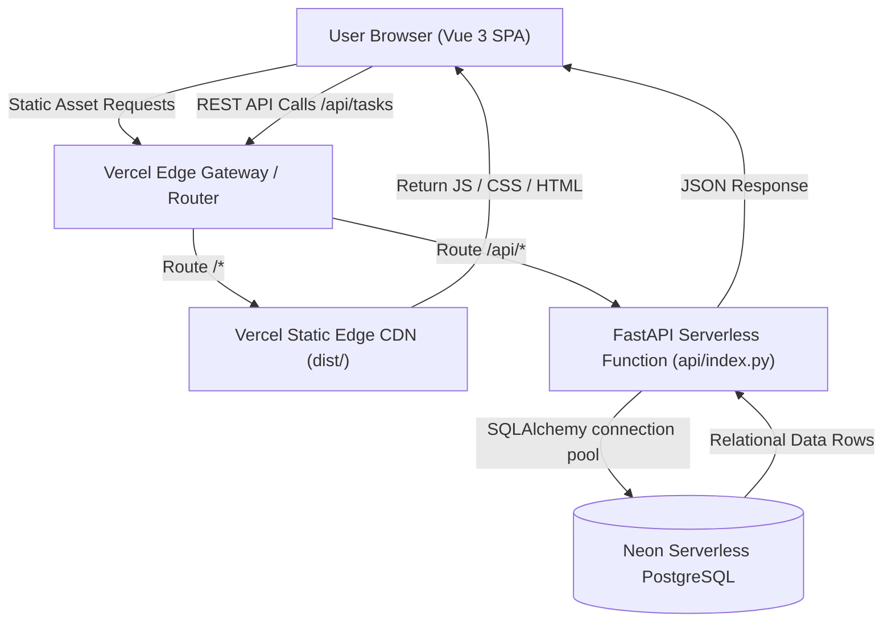

# Neobrutalist Task List (FastAPI + Vue 3 + Neon PostgreSQL on Vercel)

* **Author:** esjun
* **Date:** 2026-11-03
* **Status:** Approved

---

## The Problem

Standard task management interfaces frequently suffer from two opposing extremes:
1. **Feature bloat and cognitive friction:** Most commercial to-do applications enforce multi-step metadata entry (projects, tags, priority matrices, subtasks, estimated durations), creating unnecessary overhead for users who simply need to capture, track, and clear immediate daily activities.
2. **Generic visual monotony:** Minimalist productivity tools often adopt indistinguishable, sterile monochromatic designs that lack visual hierarchy, tactile responsiveness, and personality.

Furthermore, deploying small full-stack prototypes (such as a Python backend combined with a reactive frontend) to modern serverless hosting platforms like Vercel introduces severe operational traps. Ephemeral serverless containers discard local file storage on restart, causing data loss when developers mistakenly rely on local SQLite files.

This project solves this problem by delivering a focused, single-user task management application with a high-contrast neobrutalist aesthetic, tactile interaction feedback, zero-friction task operations (add, toggle, remove), and reliable cloud-backed serverless persistence on Vercel via Neon PostgreSQL.

## Overview

The application is structured as a unified monorepo deploying both a client-side Single Page Application (Vue 3, TypeScript, Tailwind CSS) and a stateless REST backend (Python FastAPI) to Vercel:

* **User Experience:** An expressive, accessible neobrutalist user interface featuring 3px solid black outlines, 4px unblurred hard offset shadows, tactile click physics, and clear visual state differentiation (warm parchment canvas, white surface cards, vivid yellow and coral action highlights).
* **Core Interactions:**
  * **Add Task:** Immediate keyboard-friendly input (`Enter` to submit, automatic refocus).
  * **Toggle Completion:** High-contrast brutalist checkbox with instant strike-through feedback.
  * **Delete Task:** One-click removal with optimistic UI deletion.
  * **Filter Views:** Quick switching between All, Active, and Completed views.
* **Serverless Resilience:** A stateless Python FastAPI endpoint (`/api/tasks`) running on Vercel's serverless runtime, persisting all task state across sessions and cold starts to a serverless Neon PostgreSQL instance via SQLAlchemy connection pooling.

## Goals

* **G1: High-Speed Zero-Friction Task Operations:** Enable users to capture, mark, and purge tasks with sub-100ms perceived response times using optimistic client-side updates.
* **G2: Distinct Tactile Neobrutalist Design:** Deliver a polished visual system matching the reference aesthetic—3px black borders, 4px hard drop shadows, distinct press states (`translate(2px, 2px)`), and a high-contrast color palette without causing visual fatigue.
* **G3: Stateless Serverless Reliability:** Ensure zero data loss across Vercel function cold starts, scaling, and re-deployments by binding the backend directly to Neon PostgreSQL.
* **G4: Pragmatic Component Architecture:** Maintain a flat, clean component architecture (`TaskInput`, `TaskItem`, `TaskFilter`, `BrutalButton`) avoiding premature multi-layer Atomic Design fragmentation.
* **G5: Keyboard Accessibility:** Provide full keyboard operability for task entry (`Enter` to add), toggling (`Space` or click), and accessible focus indicators.

## Non-Goals

* **NG1: Multi-User Accounts & Authentication:** The application is built for single-user productivity. User registration, login, JWT session management, and multi-tenant row-level security are explicitly out of scope.
* **NG2: Complex Task Metadata:** No support for deadlines, recurring tasks, subtasks, task descriptions, labels, priorities, or project folders.
* **NG3: Real-Time Multi-Device Sync:** No WebSockets, Server-Sent Events, or collaborative live editing. Tasks refresh via standard REST requests and window focus triggers.
* **NG4: Offline ServiceWorker Caching:** PWA offline caching and local IndexedDB conflict resolution will not be implemented.
* **NG5: Multi-Tier Atomic Design Hierarchy:** No strict segregation into `atoms/`, `molecules/`, `organisms/`, and `templates/` folders.

---

## Technical Plan

### 1. High-Level Architecture & Request Flow

The system runs as a single repository hosted on Vercel. Incoming HTTP requests are divided by `vercel.json` routing:
* Browser requests for assets and HTML are served by Vercel's CDN from the compiled `dist/` bundle (Vite + Vue 3).
* API requests matching `/api/(.*)` trigger an ephemeral Python serverless function running FastAPI (`api/index.py`), which establishes a pooled SSL connection to Neon PostgreSQL.



### 2. Repository Layout

```
.
├── api/
│   ├── index.py              # Vercel entrypoint; exposes FastAPI app
│   ├── config.py             # Database URL and environment parsing
│   ├── database.py           # SQLAlchemy engine & session factory
│   ├── models.py             # Task ORM model definition
│   ├── schemas.py            # Pydantic v2 validation models
│   └── routers/
│       └── tasks.py          # /api/tasks route implementations
├── src/
│   ├── assets/
│   │   └── main.css          # Tailwind base & custom brutalist utilities
│   ├── components/
│   │   ├── BrutalButton.vue  # Tactile button primitive
│   │   ├── TaskInput.vue     # Input text bar with submit trigger
│   │   ├── TaskItem.vue      # Individual task card with checkbox & delete
│   │   └── TaskFilter.vue    # Brutalist filter segmented control
│   ├── stores/
│   │   └── taskStore.ts      # Pinia store managing optimistic state
│   ├── services/
│   │   └── taskApi.ts        # Typed HTTP client for /api/tasks
│   ├── types/
│   │   └── task.ts           # Shared TypeScript interfaces
│   ├── App.vue               # Main application container
│   └── main.ts               # Vue application bootstrap
├── index.html
├── package.json              # Vue, Vite, Tailwind, Pinia dependencies
├── requirements.txt          # fastapi, uvicorn, sqlalchemy, psycopg2-binary, pydantic
├── tailwind.config.js        # Neobrutalist design token extensions
├── tsconfig.json
├── vercel.json               # Vercel serverless function & routing configuration
└── vite.config.ts            # Vite build configuration with /api proxy for local dev
```

### 3. Backend Architecture (FastAPI & Neon PostgreSQL)

#### 3.1 Persistence & Data Schema
The database uses a single relational table `tasks`:

```sql
CREATE TABLE tasks (
    id SERIAL PRIMARY KEY,
    title VARCHAR(255) NOT NULL,
    is_completed BOOLEAN NOT NULL DEFAULT FALSE,
    created_at TIMESTAMP WITH TIME ZONE DEFAULT CURRENT_TIMESTAMP NOT NULL,
    updated_at TIMESTAMP WITH TIME ZONE DEFAULT CURRENT_TIMESTAMP NOT NULL
);

CREATE INDEX idx_tasks_status ON tasks(is_completed);
CREATE INDEX idx_tasks_created ON tasks(created_at DESC);
```

#### 3.2 SQLAlchemy Configuration for Serverless PostgreSQL
Because serverless functions invoke new threads and processes on demand, the SQLAlchemy engine is configured for connection pooling and SSL encryption:

```python
# api/database.py
import os
from sqlalchemy import create_engine
from sqlalchemy.orm import sessionmaker, declarative_base

DATABASE_URL = os.environ.get("DATABASE_URL")
if DATABASE_URL and DATABASE_URL.startswith("postgres://"):
    DATABASE_URL = DATABASE_URL.replace("postgres://", "postgresql://", 1)

engine = create_engine(
    DATABASE_URL,
    pool_size=5,
    max_overflow=10,
    pool_pre_ping=True,
    connect_args={"sslmode": "require"}
)
SessionLocal = sessionmaker(autocommit=False, autoflush=False, bind=engine)
Base = declarative_base()

def get_db():
    db = SessionLocal()
    try:
        yield db
    finally:
        db.close()
```

#### 3.3 Data Contracts & Endpoints

| Method | Route | Description | Request Body | Response Code / Body |
| :--- | :--- | :--- | :--- | :--- |
| `GET` | `/api/tasks` | List tasks | None (query: `filter=all\|active\|completed`) | `200 OK` → `List[TaskResponse]` |
| `POST` | `/api/tasks` | Create task | `TaskCreate` (`title`: 1-255 chars) | `201 Created` → `TaskResponse` |
| `PATCH` | `/api/tasks/{id}` | Update task | `TaskUpdate` (`is_completed`, optional `title`) | `200 OK` → `TaskResponse` (or `404`) |
| `DELETE` | `/api/tasks/{id}` | Delete task | None | `204 No Content` (or `404`) |

Validation invariants:
* Empty strings or whitespace-only submissions return `422 Unprocessable Entity`.
* Titles longer than 255 characters return `422 Unprocessable Entity`.
* Non-existent ID updates or deletes return `404 Not Found`.

### 4. Frontend Architecture (Vue 3 + Pinia + Tailwind)

#### 4.1 Component Responsibilities
* **`App.vue`:** Centers the brutalist card container, displays header typography and summary count, and renders the composed views.
* **`TaskInput.vue`:** Input field with 3px black border and submit button. Submits on `Enter` or button press; clears text and automatically refocuses the input.
* **`TaskItem.vue`:** Renders the task row. Contains a custom square brutalist checkbox (`BaseCheckbox` or styled input), task title with strike-through when completed, and a tactile coral delete button.
* **`TaskFilter.vue`:** Renders three segmented pill buttons (`All`, `Active`, `Completed`) with high-contrast active states.
* **`BrutalButton.vue`:** Shared button primitive handling variants (`yellow`, `coral`, `mint`, `white`) and uniform tactile click translation (`translate(2px, 2px)`).

#### 4.2 Optimistic State Management (`taskStore.ts`)
To eliminate network latency from the user experience, Pinia executes immediate optimistic updates:
1. **Toggle Action:**
   * Inverts `task.is_completed` in memory instantly.
   * Dispatches `PATCH /api/tasks/{id}` in the background.
   * If the network call fails: rolls back the boolean state and displays an error alert.
2. **Delete Action:**
   * Removes task from local array immediately.
   * Dispatches `DELETE /api/tasks/{id}`.
   * If the network call fails: reinserts the task at its original index and displays an alert.
3. **Creation Action:**
   * Sends `POST /api/tasks`. Upon `201 Created` response, prepends the returned server task entity to the array.

### 5. Neobrutalism Design System Implementation

The theme extension in `tailwind.config.js` formalizes the design language:

```javascript
// tailwind.config.js
module.exports = {
  content: ['./index.html', './src/**/*.{vue,js,ts}'],
  theme: {
    extend: {
      colors: {
        brutal: {
          bg: '#FFFDF5',        // Warm canvas parchment
          surface: '#FFFFFF',   // Card background
          black: '#121212',     // Borders, text, hard shadows
          yellow: '#FFE600',    // Primary action color
          mint: '#00F0A8',      // Completed task indicator
          coral: '#FF5C5C',     // Delete / destructive action
          lavender: '#D4B8FF',  // Secondary decorative accent
        }
      },
      borderWidth: {
        3: '3px',
      },
      boxShadow: {
        brutal: '4px 4px 0px 0px #121212',
        'brutal-hover': '2px 2px 0px 0px #121212',
        'brutal-pressed': '0px 0px 0px 0px #121212',
        'brutal-card': '6px 6px 0px 0px #121212',
      }
    }
  }
}
```

Interactive elements implement uniform physics classes:
```css
/* Tactile Press Physics */
.brutal-interactive {
  transition: transform 0.08s ease-in-out, box-shadow 0.08s ease-in-out;
}
.brutal-interactive:hover {
  transform: translate(2px, 2px);
  box-shadow: 2px 2px 0px 0px #121212;
}
.brutal-interactive:active {
  transform: translate(4px, 4px);
  box-shadow: 0px 0px 0px 0px #121212;
}
```

### 6. Vercel Monorepo Deployment Specification (`vercel.json`)

The deployment relies on Vercel's standard configuration:

```json
{
  "version": 2,
  "builds": [
    {
      "src": "api/index.py",
      "use": "@vercel/python"
    },
    {
      "src": "package.json",
      "use": "@vercel/static-build",
      "config": {
        "distDir": "dist"
      }
    }
  ],
  "routes": [
    {
      "src": "/api/(.*)",
      "dest": "api/index.py"
    },
    {
      "src": "/(.*)",
      "dest": "/$1"
    }
  ]
}
```

---

## Alternatives Considered

### 1. Local File-Based SQLite Database
* **Concept:** Store tasks in a local `tasks.db` SQLite file on disk using SQLAlchemy.
* **Why Rejected:** Vercel serverless functions run in ephemeral, read-only containers (except for a temporary `/tmp` partition). Any database file written to the container filesystem is discarded on instance cold starts, scaling events, or new deployments. Furthermore, multiple concurrent requests spin up separate serverless instances, resulting in split-brain data divergence and SQLite file-lock exceptions.
* **Decision:** Connect the FastAPI backend to Neon PostgreSQL over SSL with connection pooling, guaranteeing data persistence across all serverless invocations.

### 2. Document Store / MongoDB Atlas
* **Concept:** Use a cloud-hosted MongoDB cluster for task storage.
* **Why Rejected:** MongoDB introduces non-relational document paradigms, dynamic schema drift risks, and additional client dependencies (e.g., `motor` or `pymongo`) for what is fundamentally a single-entity relational model.
* **Decision:** Adopt PostgreSQL via Neon, preserving ACID guarantees, relational type enforcement, and direct compatibility with SQLAlchemy ORM and Pydantic v2 schemas.

### 3. Deep Multi-Tier Atomic Design Architecture
* **Concept:** Structure the frontend across five hierarchical directories: `atoms/`, `molecules/`, `organisms/`, `templates/`, and `pages/`.
* **Why Rejected:** For an application with only three core operations (add, toggle, delete), full Atomic Design introduces severe over-engineering. Splitting simple UI elements (such as checkboxes, text labels, and buttons) into micro-files leads to deep prop-drilling, excessive boilerplate indirection, and maintenance friction.
* **Decision:** Implement a pragmatic, single-tier component structure (`TaskInput.vue`, `TaskItem.vue`, `TaskFilter.vue`, `BrutalButton.vue`). Foundational reusable primitives remain isolated, while specific UI compositions live directly in their functional components.

### 4. Pure Browser LocalStorage Persistence
* **Concept:** Eliminate backend persistence entirely and persist task arrays in the user's browser `localStorage`.
* **Why Rejected:** While zero-cost and completely client-contained, this violates the user's explicit requirement for a Python full-stack implementation and prevents practicing REST API contracts and server-side data validation.
* **Decision:** Retain a real Python FastAPI REST backend deployed as Vercel serverless functions backed by Neon PostgreSQL.

### 5. Multi-Provider Split Hosting (Vercel + Render / Railway)
* **Concept:** Host the Vue 3 frontend on Vercel and host the Python FastAPI backend on a continuous container service (like Render or Railway) with a mounted persistent disk for SQLite.
* **Why Rejected:** Managing two hosting providers introduces separate billing/dashboards, disjointed git deployment triggers, complex CORS configuration across different domains, and potential inter-region network latency.
* **Decision:** Deploy both the frontend SPA and the Python backend in a single repository on Vercel using `vercel.json` path rewrites (`/api/*` to `api/index.py`), ensuring unified deployments and zero CORS friction.

---

## Detailed Implementation Plan

The implementation follows a sequenced, five-phase progression. Every file touched, created, or configured is explicitly enumerated below with its architectural rationale.

### File Manifest & Responsibilities

| File Path | Action | Rationale |
| :--- | :--- | :--- |
| `vercel.json` | Create | Defines deployment orchestration on Vercel, mapping `api/index.py` to `@vercel/python`, `package.json` to `@vercel/static-build`, and rewriting `/api/(.*)` routes. |
| `requirements.txt` | Create | Lists Python runtime dependencies: `fastapi`, `uvicorn[standard]`, `sqlalchemy`, `psycopg2-binary`, and `pydantic`. |
| `api/index.py` | Create | ASGI serverless entrypoint for Vercel; instantiates FastAPI, attaches CORS middleware, and executes table creation in lifespan startup. |
| `api/config.py` | Create | Centralizes environment configuration, loading `DATABASE_URL` and converting legacy Postgres URI schemes. |
| `api/database.py` | Create | Initializes SQLAlchemy pooled engine with SSL connection flags (`sslmode=require`) and provides the `get_db` generator dependency. |
| `api/models.py` | Create | Defines the `Task` SQLAlchemy ORM entity with fields, constraints, and indexes on `is_completed` and `created_at`. |
| `api/schemas.py` | Create | Defines Pydantic v2 schemas: `TaskBase`, `TaskCreate`, `TaskUpdate`, and `TaskResponse` with string trimming and validation. |
| `api/routers/__init__.py` | Create | Package initialization for API routers. |
| `api/routers/tasks.py` | Create | Implements the four REST endpoint handlers (`GET`, `POST`, `PATCH`, `DELETE`) with database dependency injection. |
| `package.json` | Create | Configures Node project scripts (`dev`, `build`, `preview`) and frontend dependencies (`vue`, `pinia`, `tailwindcss`, `autoprefixer`, `postcss`, `vite`). |
| `vite.config.ts` | Create | Configures Vite bundler with `@vitejs/plugin-vue`, sets output directory to `dist/`, and provides an API proxy mapping `/api` to local FastAPI during development. |
| `tsconfig.json` | Create | Configures TypeScript compiler settings, path aliases, and strict type checking for Vue single-file components. |
| `tailwind.config.js` | Create | Registers custom neobrutalist theme extensions: 3px borders, hard 4px drop-shadows, and high-contrast brutalist color tokens. |
| `postcss.config.js` | Create | Connects Tailwind CSS and Autoprefixer to the Vite CSS post-processing pipeline. |
| `index.html` | Create | HTML shell with responsive viewport tags, punchy brutalist page title, and Google Fonts links. |
| `src/main.ts` | Create | Client application entrypoint; initializes Vue 3, installs the Pinia state management plugin, and mounts to the DOM. |
| `src/assets/main.css` | Create | Injects Tailwind layers (`base`, `components`, `utilities`) and declares global tactile physics utility classes. |
| `src/types/task.ts` | Create | Declares TypeScript interfaces: `Task`, `TaskCreateDTO`, `TaskUpdateDTO`, and `TaskFilterType`. |
| `src/services/taskApi.ts` | Create | Provides typed asynchronous HTTP client methods for `/api/tasks` using the native `fetch` API. |
| `src/stores/taskStore.ts` | Create | Central Pinia store maintaining reactive task state, filter selections, and optimistic UI mutations with rollback on error. |
| `src/components/BrutalButton.vue` | Create | Reusable brutalist button primitive with tactile press translation and configurable color variants (`yellow`, `coral`, `mint`, `white`). |
| `src/components/TaskInput.vue` | Create | Task creation form component featuring thick black border input, submit trigger, and autofocus management. |
| `src/components/TaskItem.vue` | Create | Renders individual task card with custom brutalist checkbox, text strike-through on completion, and delete button. |
| `src/components/TaskFilter.vue` | Create | Segmented pill control enabling the user to switch active list view between `All`, `Active`, and `Completed`. |
| `src/App.vue` | Create | Main application frame assembling header typography, summary status pill, input bar, filter tabs, and the task list. |
| `.env.example` | Create | Documents required environment variables (`DATABASE_URL`) for local execution and Vercel project settings. |
| `.gitignore` | Create | Excludes build artifacts (`dist/`), dependencies (`node_modules/`, `venv/`), environment secrets (`.env`), and cache files. |
| `README.md` | Create | Step-by-step documentation detailing local development setup, Neon database provisioning, and one-click Vercel deployment. |

---

### Step-by-Step Implementation Sequence

#### Phase 1: Environment & Project Scaffolding
1. **Repository Structure:** Initialize the workspace with `.gitignore`, `package.json`, `requirements.txt`, and `vercel.json`.
2. **Frontend Tooling:** Install Vue 3, Vite, TypeScript, Tailwind CSS, PostCSS, Autoprefixer, and Pinia. Configure `vite.config.ts`, `tailwind.config.js`, and `postcss.config.js`.
3. **Configuration Templates:** Create `.env.example` defining `DATABASE_URL` pointing to Neon PostgreSQL.

#### Phase 2: Backend Architecture & Persistence
1. **Database Connection (`api/database.py`):**
   * Configure SQLAlchemy engine with `pool_size=5`, `max_overflow=10`, `pool_pre_ping=True`, and `connect_args={"sslmode": "require"}`.
   * Implement `get_db()` dependency generator to yield and safely close sessions per request.
2. **Domain Models (`api/models.py`):**
   * Define `Task` model mapping to table `tasks` with autoincrement primary key `id`, non-null `title` (VARCHAR 255), boolean `is_completed` (default false), and timezone-aware UTC timestamps.
3. **Data Schemas (`api/schemas.py`):**
   * Create `TaskBase` with trimmed string title validation (min length 1, max length 255).
   * Create `TaskCreate`, `TaskUpdate` (optional title and boolean completion), and `TaskResponse` (with `from_attributes=True` for ORM serialization).
4. **Endpoint Implementation (`api/routers/tasks.py`):**
   * `GET /api/tasks`: Query tasks with optional query filter (`all`, `active`, `completed`), ordered by completion status ascending and creation date descending.
   * `POST /api/tasks`: Validate payload, insert task entity, commit transaction, and return `201 Created`.
   * `PATCH /api/tasks/{id}`: Locate task by ID (returning `404` if missing), apply non-null fields, update `updated_at`, commit, and return `200 OK`.
   * `DELETE /api/tasks/{id}`: Locate task by ID (returning `404` if missing), delete record, commit, and return `204 No Content`.
5. **FastAPI Lifespan Bootstrap (`api/index.py`):**
   * Wrap application initialization in a lifespan context that executes `Base.metadata.create_all(bind=engine)` to ensure the `tasks` table exists on Neon without manual migrations.
   * Configure `CORSMiddleware` with allowed origins `["*"]` for development and serverless routing.

#### Phase 3: Neobrutalism Design System Foundation
1. **Tailwind Design Tokens (`tailwind.config.js`):**
   * Define brutalist palette (`brutal-bg: #FFFDF5`, `brutal-surface: #FFFFFF`, `brutal-black: #121212`, `brutal-yellow: #FFE600`, `brutal-mint: #00F0A8`, `brutal-coral: #FF5C5C`, `brutal-lavender: #D4B8FF`).
   * Configure border width extension `border-3: 3px`.
   * Configure hard offset box-shadow extensions (`shadow-brutal: 4px 4px 0px 0px #121212`, `shadow-brutal-hover: 2px 2px 0px 0px #121212`, `shadow-brutal-card: 6px 6px 0px 0px #121212`).
2. **Global Styles (`src/assets/main.css`):**
   * Add Tailwind base layer and reset body background to `brutal-bg` with default text color `brutal-black`.
   * Declare `.brutal-interactive` transition classes providing smooth `0.08s` tactile translations (`translate(2px, 2px)` on hover, `translate(4px, 4px)` on active click).
3. **Reusable Primitives (`src/components/BrutalButton.vue`):**
   * Implement button component accepting `variant` (`yellow`, `coral`, `mint`, `white`) and `disabled` state with tactile press physics and 3px black borders.

#### Phase 4: State Management & Component Composition
1. **API Client Service (`src/services/taskApi.ts`):**
   * Implement typed helper functions (`fetchTasks`, `createTask`, `updateTask`, `deleteTask`) interacting with `/api/tasks`.
2. **Reactive Pinia Store (`src/stores/taskStore.ts`):**
   * State: `tasks: Task[]`, `currentFilter: 'all' | 'active' | 'completed'`, `isLoading: boolean`, `errorMessage: string | null`.
   * Getters: `filteredTasks` returning computed tasks matching the active filter; `taskCounts` returning totals for all, active, and completed.
   * Optimistic Actions:
     * `toggleTask(id)`: Immediately flip `is_completed` in memory; dispatch API call; revert and set error message on failure.
     * `removeTask(id)`: Immediately splice task from array; dispatch API delete; restore task at original index on failure.
     * `addTask(title)`: Post new task; on success, unshift server response into array.
3. **Direct Components Assembly:**
   * `src/components/TaskInput.vue`: Build input bar with 3px border, placeholder, and submit button. Add autofocus on mount and after successful creation.
   * `src/components/TaskItem.vue`: Build card with custom square checkbox, dynamic strike-through styling, creation timestamp, and delete button using `BrutalButton`.
   * `src/components/TaskFilter.vue`: Build segmented pill tabs with badge count bubbles reflecting `taskCounts`.
4. **Application Assembly (`src/App.vue`):**
   * Construct centered card container (`max-w-xl mx-auto my-12`) with `shadow-brutal-card` and `border-3 border-black`.
   * Render expressive brutalist header banner (`"TASK // BOARD"`), summary counter pill, `TaskInput`, `TaskFilter`, and the scrollable list of `TaskItem` components.
   * Add empty state visual card displayed when the active filter yields zero tasks.

#### Phase 5: Verification, Hardening & Deployment Configuration
1. **Local Integration Verification:**
   * Run local FastAPI backend (`uvicorn api.index:app --reload`) and Vite frontend (`npm run dev`).
   * Test task creation with standard text, whitespace trimming, and empty string rejection (`422`).
   * Verify optimistic toggle and delete behavior.
   * Verify keyboard navigation: `Enter` submits new task, `Tab` traverses interactive elements cleanly, `Space` toggles task checkbox.
2. **Vercel Deployment Verification:**
   * Configure `vercel.json` and verify build compatibility (`npm run build` generates `dist/`).
   * Push code to repository and link to Vercel project.
   * Set environment variable `DATABASE_URL` in Vercel project settings with Neon PostgreSQL connection string.
   * Execute live deployment test to confirm `/api/tasks` functions correctly across cold starts.
